 <div align="center">

# 🚀 Deep Learning Practical Exam — Set C


<p>


</p>

**A Hands-On Deep Learning Project Using Python, Neural Networks, Computer Vision and NLP**

[Project Overview](#-project-overview) • [Practical Tasks](#-practical-tasks) • [Results](#-results-at-a-glance) • [Installation](#️-installation-and-setup)

</div>

---


## ✨ Project Overview

This project, **Deep Learning Practical Exam — Set C**, contains five practical tasks covering fundamental and advanced concepts in deep learning.

The project starts with an Artificial Neural Network (ANN) for Wine dataset classification, explores image-processing techniques using OpenCV, builds a Convolutional Neural Network (CNN) for handwritten digit recognition, applies a Recurrent Neural Network (RNN) to IMDB sentiment analysis, and explores Transformer-based natural language processing.

Each practical focuses on implementing the required techniques, examining outputs, evaluating performance, visualising results and documenting observations.

### 📌 Project at a Glance

| Category | Details |
|---|---|
| Project Name | Deep Learning Practical Exam — Set C |
| Programming Language | Python |
| Development Environment | Jupyter Notebook / VS Code |
| Practical Tasks | 5 |
| Main Areas | ANN, OpenCV, CNN, RNN, Transformers |
| Datasets | Wine, sample images, MNIST, IMDB |
| Deep Learning Framework | TensorFlow / Keras |
| Computer Vision Library | OpenCV |
| NLP Library | Hugging Face Transformers |
| Evaluation | Accuracy, loss, confusion matrix, classification metrics and visualisations |

## 🎯 Project Objectives

- Understand the fundamentals of artificial neural networks.
- Perform data inspection, preprocessing and feature scaling.
- Apply image-processing techniques using OpenCV.
- Build and evaluate CNN models for handwritten digit classification.
- Understand recurrent networks and sequence-based sentiment analysis.
- Explore pretrained language models and Transformer encoder architecture.
- Generate predictions and interpret confidence scores.
- Visualise model performance and document practical observations.
- Save and reload trained models where required.

---

## 📊 Results at a Glance

The following table summarises the main outputs expected from each practical. Add your actual results after running the notebooks.

| Task | Model / Technique | Main Output | Result |
|---|---|---|---|
| 1 | ANN — Wine Dataset | Multiclass classification, accuracy and confusion matrix | 100 |
| 2 | OpenCV | Colour conversion, masking, morphology, edges and face detection | __ |
| 3 | CNN — MNIST | Digit classification, training curves and feature maps | 98 |
| 4 | RNN — IMDB | Positive/negative sentiment predictions and evaluation metrics | 80 |
| 5 | Transformer — NLP | Fill-mask predictions, encoder, model evaluation and visualisation | 86 |

> **Note:** Final scores depend on your executed notebooks. Placeholder values are not model results.

---

# 🧠 Task 1 — ANN Wine Classification


## 🎯 Objective

Build an Artificial Neural Network to classify Wine dataset samples into three target classes.

## 🔹 Task 1.1 — Dataset Loading and Inspection

- Import the required Python libraries.
- Load the Wine dataset.

###  Wine Class Distribution

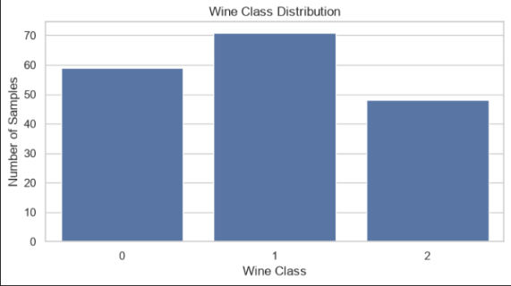

**Conclusion:** The class distribution shows how wine samples are distributed among the target classes.

### Feature Distributions Before Scaling

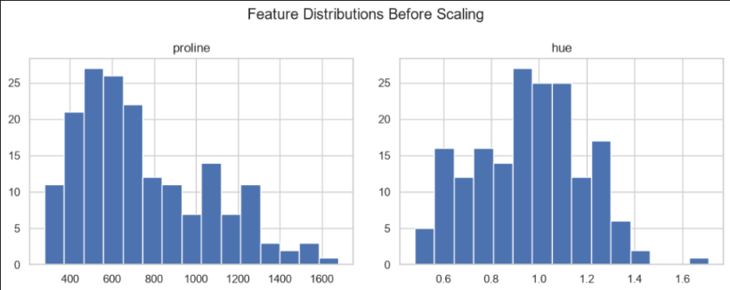

**Conclusion:** The plots show differences in feature ranges, explaining why feature scaling is useful before ANN training.

- Store the dataset in a pandas DataFrame named `df`.
- Inspect the dataset shape, columns, data types and sample rows.
- Examine the target-class distribution.

## 🔹 Task 1.2 — Data Preprocessing

- Separate input features and target labels.
- Divide the dataset into training and testing sets.
- Scale numerical features using `StandardScaler`.
- Prepare the target labels for multiclass classification.

## 🔹 Task 1.3 — Build the ANN Model

Build a feed-forward neural network using Keras.

**Model architecture:**

```text
Input Features
      ↓
Dense Layer — 16 Neurons, ReLU
      ↓
Dense Layer — 8 Neurons, ReLU
      ↓
Output Layer — 3 Neurons, Softmax
      ↓
Predicted Wine Class
```

The hidden layers learn relationships between the input features, while the Softmax output produces class probabilities.

###  ANN Training and Validation Accuracy

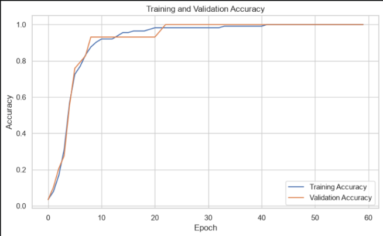

**Conclusion:** The accuracy curves show how the ANN's classification performance changes across training epochs.

###  ANN Training and Validation Loss

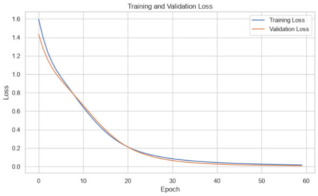

**Conclusion:** The loss curves help assess model learning and identify possible overfitting.

### ANN Wine Confusion Matrix

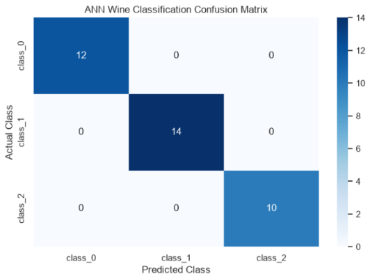

**Conclusion:** The confusion matrix shows the correct and incorrect predictions for each wine class.

## 🔹 Task 1.4 — Evaluation and Conclusion

- Train the ANN model.
- Evaluate it on the test dataset.
- Plot training results where included in the notebook.
- Generate a confusion matrix.
- Save the trained model.

**Expected saved model:** `ann_wine_model.h5`, if this is the filename used in your notebook.

### 📈 Results

| Metric | Result |
|---|---|
| Number of classes | 3 |
| Test accuracy | 100 |
| Saved model | ann_wine_model.h5 |

**Key learning:** Data preprocessing and feature scaling help prepare tabular data for neural-network training.

---

# 🖼️ Task 2 — OpenCV Image Processing


### 🎯 Objective

Understand digital images and implement common image-processing and computer-vision techniques using OpenCV.

### 🔹 Task 2.1 — Load and Inspect Images

- Import OpenCV and other required libraries.
- Load sample or supplied images.
- Display images.

###  OpenCV Original Images

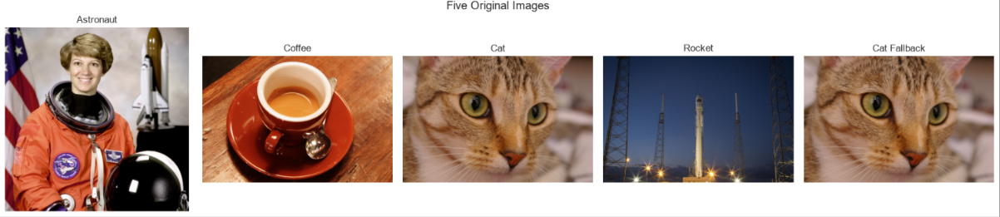

**Conclusion:** The original images provide a baseline for comparing the effects of image-processing operations.
- Inspect image shape, dimensions, number of channels and data type.

## 🔹 Task 2.2 — Colour Space Conversion

- Understand the difference between BGR and RGB.
- Convert images between colour spaces.
- Explore HSV colour representation.

###  OpenCV HSV Images

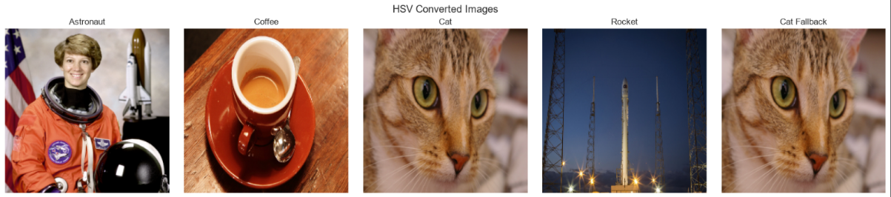

**Conclusion:** HSV representation separates colour information from brightness, making colour-based segmentation easier in suitable images.

- Observe how colour conversion changes image representation.

###  Blue Colour Mask and Segmentation

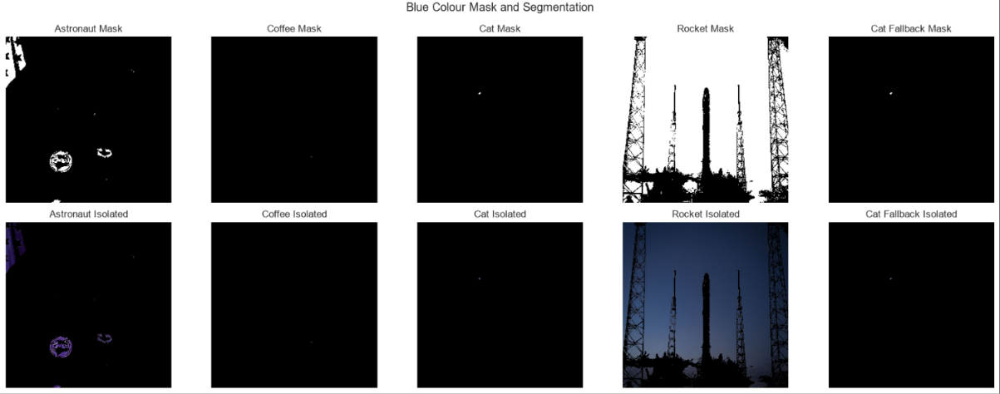

**Conclusion:** The colour mask highlights image regions that fall within the selected blue-colour range.

## 🔹 Task 2.3 — Image Processing Operations

Apply image-processing techniques included in the notebook:

- Colour-based masking and segmentation.
- Erosion and dilation.
- Morphological operations.

###  Morphology — Erosion and Dilation

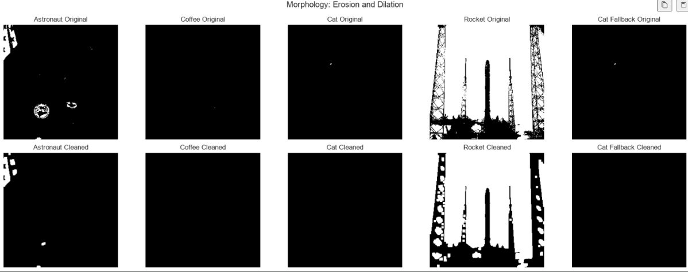

**Conclusion:** Erosion and dilation modify foreground regions in a mask and can help refine segmented image areas.

- Sobel edge detection.

###  Sobel Edge Detection

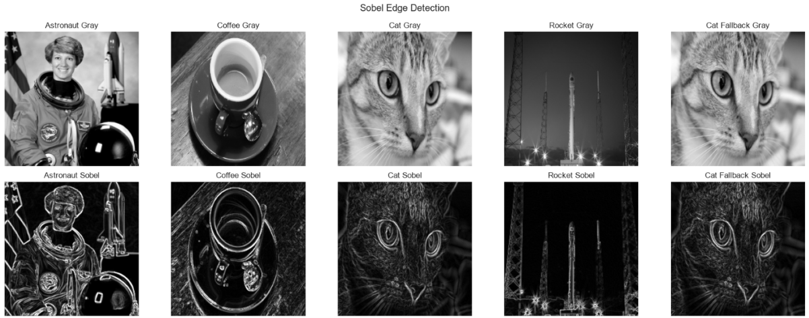

**Conclusion:** Sobel edge detection highlights intensity changes that can indicate object boundaries and image structure.

- Visual comparison of original and processed images.

### Haar Cascade Face Detection

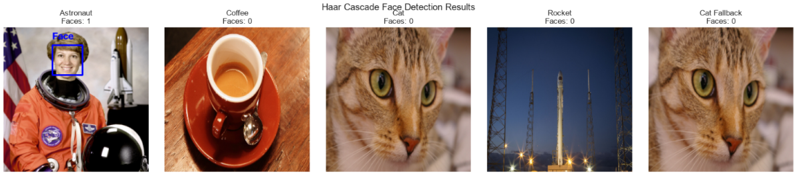

**Conclusion:** Haar cascade detection identifies candidate face regions based on the detector settings and image content.


## 🔹 Task 2.4 — Face Detection and Comparison

- Use a Haar cascade for face detection.
- Compare detection settings such as `minNeighbors`.
- Display detected faces and bounding boxes.
- Record how changing parameters affects detection.

### 🛠️ Main Techniques

| Technique | Purpose |
|---|---|
| Image loading | Read image data into Python |
| BGR to RGB | Display OpenCV images with correct colours in plotting libraries |
| HSV conversion | Represent colour information for segmentation |
| Colour masking | Select pixels within a specified colour range |
| Erosion and dilation | Modify foreground regions in binary masks |
| Sobel operator | Highlight image intensity changes |
| Haar cascade | Detect potential faces in images |


```python
%pip install scikit-image
```

If an image file is missing, upload it to the notebook's working directory or use the sample-image fallback included in the notebook.

---

# 🔢 Task 3 — CNN MNIST Digit Classification


### 🎯 Objective

Classify handwritten digits from the MNIST dataset and compare a basic ANN with a Convolutional Neural Network.

# 🔹 Task 3.1 — Load and Explore MNIST

- Load the MNIST dataset.

###  MNIST Handwritten Samples

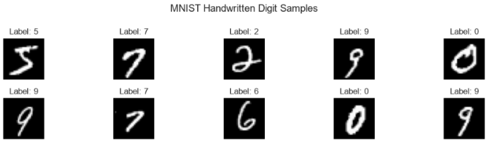

**Conclusion:** The sample images illustrate the variation in handwritten digits that the classification model must recognise.

- Inspect training and testing image shapes.
- Examine digit labels.
- Display sample handwritten digits.

MNIST contains grayscale handwritten digit images representing classes from 0 to 9.

## 🔹 Task 3.2 — Preprocessing and ANN Baseline

- Normalise pixel values.
- Prepare image dimensions for model input.
- Build a basic ANN baseline.
- Train and evaluate the baseline model.

## 🔹 Task 3.3 — Build and Train a CNN

- Create convolutional layers to learn image features.
- Use pooling layers to reduce spatial dimensions.
- Add classification layers.
- Train the CNN.
- Plot training and validation accuracy and loss.

###  ANN vs CNN Accuracy

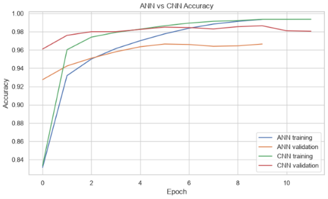

**Conclusion:** The accuracy comparison shows how the ANN baseline and CNN perform on the evaluated digit-classification task.

###  ANN vs CNN Loss

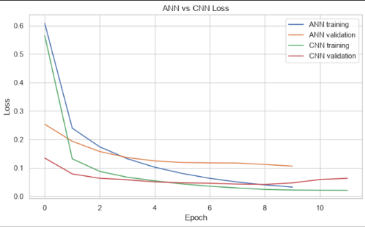

**Conclusion:** The loss comparison helps evaluate how the ANN and CNN learn and how their training behaviour differs.

- Evaluate predictions using suitable classification metrics.

###  CNN Confusion Matrix

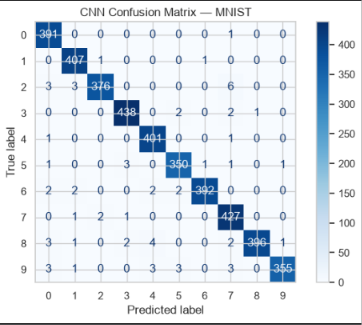

**Conclusion:** The confusion matrix reveals which handwritten digit classes are predicted correctly and which are confused.

###  CNN Feature Maps

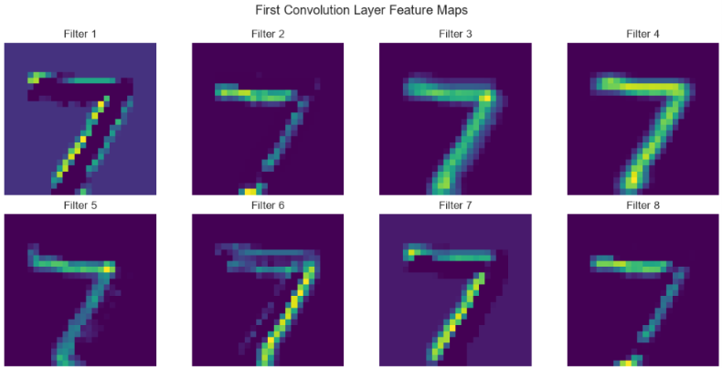

**Conclusion:** Feature maps visualise the activations produced by convolutional filters when processing an input image.

**CNN workflow:**

```text
Input Image (28 × 28)
         ↓
Convolution Layer
         ↓
Activation Function
         ↓
Pooling Layer
         ↓
Additional Feature Extraction
         ↓
Flatten / Classification Layers
         ↓
Output: Digit 0–9
```

The exact architecture and number of layers depend on the model implemented in the notebook.

### CNN Misclassified Images

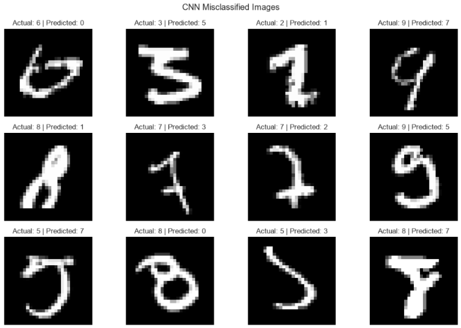

**Conclusion:** Misclassified examples help identify challenging handwriting patterns and understand the model's prediction errors.


# 🔹 Task 3.4 — Save and Reflect

- Save the trained CNN.
- Compare ANN and CNN parameter counts.
- Generate a confusion matrix.
- Visualise convolutional feature maps where supported.
- Inspect incorrectly classified images.
- Write a short conclusion about the model results.

**Expected saved model:** `cnn_mnist_model.h5`, if that is the filename used in your notebook.

### 📈 Results

| Metric | ANN Baseline | CNN |
|---|---|---|
| Test accuracy | 96 | 98 |
| Test loss | 13 | 05 |

### 💡 Key Learning

CNNs can learn spatial image patterns such as edges, curves and shapes. Feature maps help visualise the activations produced by convolutional layers, while a confusion matrix shows which digit classes are misclassified.

---

# 🔁 Task 4 — RNN IMDB Sentiment Analysis


### 🎯 Objective

Use a Recurrent Neural Network to classify movie reviews as positive or negative.

## 🔹 Task 4.1 — Load and Prepare the Dataset

- Load the IMDB sentiment dataset.

###  Training Sentiment Distribution

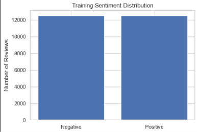

**Conclusion:** The sentiment distribution shows the balance between positive and negative reviews in the training data.

###  Review Length Distribution

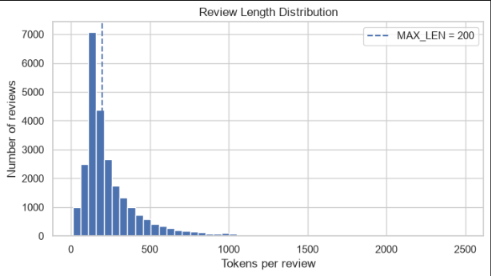

**Conclusion:** The review-length distribution helps guide the selection of a suitable sequence length for padding and truncation.

- Inspect encoded review sequences and sentiment labels.
- Prepare the input sequences.
- Pad or truncate reviews to a consistent sequence length.

## 🔹 Task 4.2 — Build the RNN Model

Create an embedding-based SimpleRNN model.

**Model architecture:**

```text
Encoded Review
      ↓
Embedding Layer
      ↓
SimpleRNN Layer
      ↓
Dense Output — Sigmoid
      ↓
Positive / Negative Sentiment
```

The embedding layer converts token IDs into vectors. The SimpleRNN processes the sequence, and the sigmoid output estimates the probability of positive sentiment.

## 🔹 Task 4.3 — Train and Evaluate

- Compile the model using a suitable optimiser and binary cross-entropy loss.
- Train the model with validation monitoring.
- Use early stopping where included.
- Plot training and validation curves.

###  SimpleRNN Accuracy

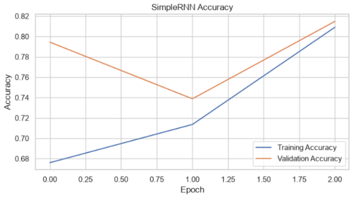

**Conclusion:** The accuracy curves show how the SimpleRNN's sentiment-classification performance changes during training.

### SimpleRNN Loss

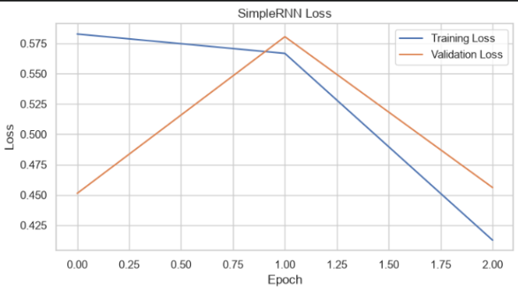

**Conclusion:** The loss curves help assess training progress and reveal possible differences between training and validation performance.

- Evaluate the model on the test data.
- Review the classification report and confusion matrix.

###  SimpleRNN Confusion Matrix

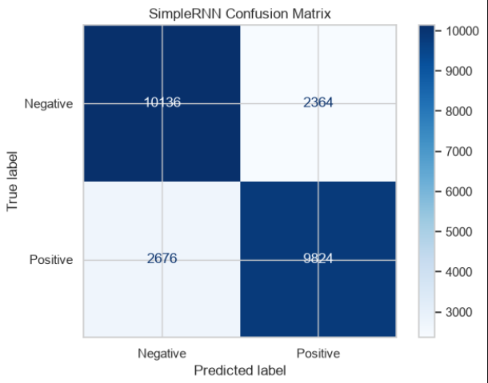

**Conclusion:** The confusion matrix summarises correct and incorrect positive and negative sentiment predictions.

- Plot the ROC curve if implemented in the notebook.

## 🔹 Task 4.4 — Save and Reflect

- Save the trained sentiment model.
- Predict sentiment for example movie reviews.
- Interpret positive-sentiment probabilities.
- Discuss the strengths and limitations of the model.

**Expected saved model:** `rnn_imdb_sentiment_model.keras`, if using the filename from the IMDB notebook.

### 📈 Results

| Metric | Result |
|---|---|
| Test accuracy | 79 |
| Test loss | 44 |
| Precision | 80 |
| Recall | 78 |
| F1-score | 80 |
| ROC-AUC | 87 |

### 💡 Key Learning

RNNs process sequential data and can use information from earlier tokens when making a prediction. Padding helps make sequences consistent in length, and classification metrics provide a more complete evaluation than accuracy alone.

---

# 🤖 Task 5 — Transformers and Natural Language Processing


### 🎯 Objective

Explore pretrained language models, fill-mask predictions, Transformer encoder components, sentiment classification and model evaluation.

## 🔹 Task 5.1 — Setup and Fill-Mask

Use Hugging Face Transformers to load the pretrained DistilBERT fill-mask pipeline.

```python
from transformers import pipeline, set_seed

# Set a random seed for reproducibility where applicable
set_seed(42)

# Load the pretrained fill-mask model
unmasker = pipeline(
    "fill-mask",
    model="distilbert-base-uncased"
)
```

The practical includes:

- Loading the pretrained fill-mask model.
- Creating five sentences containing `[MASK]`.
- Displaying the top three predicted tokens for each sentence.
- Printing each token's score.
- Testing an ambiguous sentence where several completions may be reasonable.
- Recording an observation about how the model ranks possible answers.

**Key observation:** The model ranks candidate tokens according to their contextual scores. The highest-ranked prediction is not necessarily the only valid completion.

## 🔹 Task 5.2 — Create a Transformer Encoder Block

Build a Transformer encoder using token embeddings, positional embeddings, self-attention and a feed-forward network.

**Encoder architecture:**

```text
Input Token IDs
       ↓
Token Embedding
       +
Positional Embedding
       ↓
Multi-Head Self-Attention
       ↓
Residual Connection
       ↓
Layer Normalisation
       ↓
Feed-Forward Network
       ↓
Residual Connection
       ↓
Layer Normalisation
       ↓
Encoded Token Representations
```

#### Main concepts

- **Token embedding:** Converts token IDs into numerical vectors.
- **Positional embedding:** Adds information about token positions.
- **Self-attention:** Allows the model to weigh information from different tokens in the sequence.
- **Feed-forward network:** Applies further transformations to the token representations.
- **Residual connections:** Help preserve information as it passes through the network.
- **Layer normalisation:** Helps stabilise model computation.

The practical should also verify the encoder's input and output shapes.

## 🔹 Task 5.3 — Build, Evaluate and Predict

Build the Transformer sentiment model using the components defined in the notebook.

The model workflow includes:

- Creating input tokens.
- Applying token and positional embeddings.
- Passing embedded tokens through the Transformer encoder.
- Pooling the encoded token representations.
- Applying dropout and a sigmoid output layer.
- Compiling and training the model.
- Evaluating the model on test data.

###  Transformer Accuracy

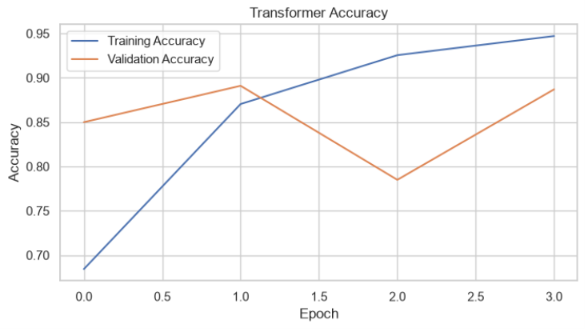

**Conclusion:** The accuracy plot shows how the Transformer model's classification performance changes across training epochs.

###  Transformer Loss

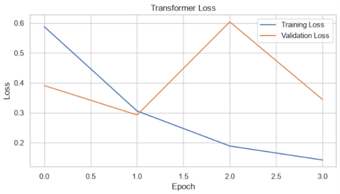

**Conclusion:** The loss plot helps assess model learning and compare training and validation behaviour.

- Predicting sentiment for example reviews.
- Saving and reloading the model where required.

### Transformer Confusion Matrix

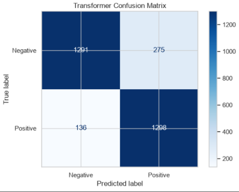

**Conclusion:** The confusion matrix shows the model's correct and incorrect sentiment-classification predictions.

### Transformer ROC Curve


**Conclusion:** The ROC curve evaluates the model's ability to distinguish between the two sentiment classes across thresholds.

**Model outline:**

```text
Input Tokens
     ↓
Token + Position Embeddings
     ↓
Transformer Encoder
     ↓
Global Average Pooling
     ↓
Dropout
     ↓
Dense Sigmoid Output
     ↓
Sentiment Probability
```

#### Model evaluation

| Metric | Result |
|---|---|
| Test loss | 32 |
| Test accuracy | 86 |
| ROC-AUC | 93 |

**Important:** `model.evaluate()` returns the loss plus one value for each metric configured during compilation. If the evaluation code expects loss, accuracy and ROC-AUC, ensure the model was compiled with both accuracy and AUC metrics.

**Custom-layer saving and loading:** If the model uses a custom `TokenAndPositionEmbedding` layer, its constructor should accept the relevant Keras configuration arguments and implement `get_config()`. Custom classes or functions may need to be supplied through `custom_objects` when loading a saved model.

## 🔹 Task 5.4 — Visualise and Reflect

Create a horizontal bar chart using the question numbers 1–10 on the y-axis and confidence scores on the x-axis.

- Use **green bars** for correct answers.
- Use **red bars** for incorrect answers.
- Use actual confidence scores and reference answers from the evaluation data.

### 5. Transformer Question-Answer Confidence Scores


**Conclusion:** The confidence chart compares the model's scores for the evaluated questions, while correctness must be checked against the reference answers.


## 🛠️ Technology Stack

| Technology | Purpose |
|---|---|
| Python | Main programming language |
| Jupyter Notebook | Interactive coding and experimentation |
| VS Code | Notebook development environment |
| NumPy | Numerical operations |
| pandas | Data inspection and manipulation |
| Matplotlib | Data visualisation and training plots |
| scikit-learn | Dataset utilities, preprocessing and evaluation |
| TensorFlow / Keras | ANN, CNN, RNN and custom Transformer components |
| OpenCV | Image processing and computer vision |
| scikit-image | Sample images or utilities where used |
| Hugging Face Transformers | Pretrained fill-mask model |

---

## ⚙️ Installation and Setup

### 1. Prepare the Python Environment

Install Python and open your project in Jupyter Notebook or VS Code. Select the Python environment that will run your notebooks.

### 2. Install Required Libraries

Run this command in a notebook cell:

```python
%pip install numpy pandas matplotlib scikit-learn tensorflow opencv-python scikit-image transformers torch
```

Install only the libraries required for the tasks you are running if your environment has compatibility constraints.

### 3. Run the Notebooks

1. Open the notebook for the practical task.
2. Select the correct Python kernel.
3. Run the cells in order.
4. Check that the required datasets and image files are available.
5. Review the generated outputs, metrics and charts.
6. Save the final notebook and add relevant screenshots to your repository.

### 4. Dataset and Internet Notes

- The Wine dataset can be loaded using scikit-learn.
- MNIST can be loaded through Keras.
- The IMDB dataset can be loaded through Keras, depending on the notebook implementation.
- Hugging Face fill-mask models may need internet access on their first run to download pretrained model files.
- OpenCV practicals may use sample images or a local image file.

---


## 🚀 Potential Improvements

- **ANN:** Compare class-level performance and review misclassified wine samples.
- **OpenCV:** Compare processing parameters and save original-versus-processed image outputs.
- **CNN:** Inspect misclassified digits and experiment with suitable architectures or augmentation.
- **RNN:** Review incorrect sentiment predictions and compare the model with a simple baseline.
- **Transformer:** Inspect fill-mask predictions, validate sentiment outputs and distinguish confidence from factual correctness.
- **Reproducibility:** Record package versions, random seeds and model configurations.
- **Documentation:** Include real screenshots and measured evaluation results.

---

## 🎓 Key Learnings

- Preparing datasets for deep-learning models.
- Building and evaluating a neural network for multiclass classification.
- Understanding image colour spaces, segmentation, morphology and edge detection.
- Learning how CNNs extract spatial features from images.
- Applying recurrent networks to sequence-based sentiment classification.
- Understanding token embeddings, positional embeddings and self-attention.
- Exploring pretrained fill-mask predictions and Transformer encoder components.
- Interpreting model metrics and prediction confidence.
- Saving and reloading models, including models with custom Keras layers.

---

## ⚠️ Limitations and Future Improvements

- Model results depend on data splits, random seeds, training configuration and software versions.
- Sample predictions do not replace evaluation on a labelled test dataset.
- Fill-mask scores do not guarantee factual correctness or a unique valid answer.
- Custom Keras layers need compatible serialisation configurations for reliable model loading.
- Screenshots and evaluation values should be added only after they have been generated by running the project.
- Further experiments can explore model architectures, training settings and error analysis.

---

## ✅ Conclusion

The Deep Learning Practical Exam — Set C project demonstrates a range of neural-network and machine-learning techniques through five practical tasks.

It begins with ANN-based Wine classification, moves to OpenCV image processing and CNN-based handwritten digit recognition, then explores RNN sentiment analysis and Transformer-based natural language processing.

Through implementation, evaluation, visualisation and reflection, this project builds practical understanding of deep-learning workflows and the strengths and limitations of different model architectures.

The final project report should include the actual results, plots, screenshots and observations produced by the executed notebooks.

---

<div align="center">

## 👨‍💻 About Me

### **Santosh Verma**

**Data Analyst | Data Scientist**

Learning and building projects in Data Science, Machine Learning, Deep Learning, Computer Vision and Natural Language Processing.

**Explore • Learn • Build • Improve**


</div>
